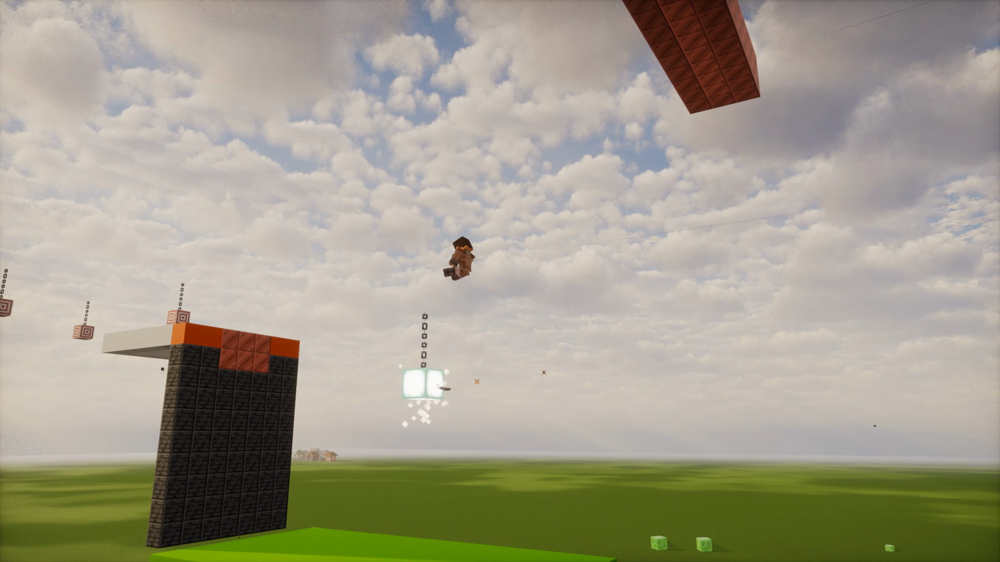
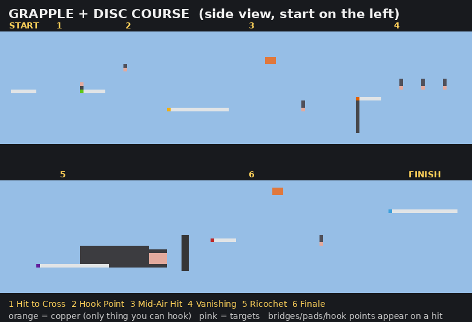

# Grapple + Disc Parkour Course in ONE command block

A 6-stage parkour course for Minecraft Java 26.3 that you can only beat with BOTH my one-command Grappling Hook and Throwing Disc. Hit targets mid-swing, bank shots off walls, ride platforms that vanish after 4 seconds... all with command blocks. No mods, no datapacks.

## What you need
This course uses the items from my other two commands, so install those first:
- **Grappling Hook:** https://github.com/damanbigc/grappling-hook-one-command
- **Throwing Disc:** https://github.com/damanbigc/throwing-disc-one-command

## How to set it up
1. Make a **Superflat** Java 26.3 world with cheats on. Creative or Survival both work.
2. Give yourself a command block: `/give @s command_block`
3. **Grappling Hook:** place a command block, paste the Grappling Hook command, face **NORTH**, power it and wait until the title shows up (about 15 seconds).
4. Walk **50 blocks EAST**. **Throwing Disc:** same thing with the Throwing Disc command, facing **SOUTH**.
5. Walk **50 more blocks EAST**. **The course:** open `Grapple_Disc_Course_one_command.txt`, copy everything, paste it into a command block, face **EAST** (an empty direction) and power it. Keep facing that way until the title **GRAPPLE + DISC** shows up.
6. You get a Grappling Hook and a Netherite Throwing Disc. The course floats **40 blocks in front of you, 24 blocks up**. Walk under it and hook the copper edge to climb onto the start.

> Keep the 3 command blocks about 50 blocks apart. Their command chains are wider than they look and will break each other if they're too close.

## Rules
- Only **COPPER** can be hooked on the course. Hooking anything else drops the hook.
- Hit the **targets** with the disc: bridges, platforms and new copper hook points appear. They only last a few seconds and turn red / tarnished just before they vanish.
- Fall off = back to your last checkpoint, **+1 fail**. The stage resets.
- Stand on the **emerald** at the start for fresh gear. It also resets the clock and your fails.
- The boss bar shows your time, your fails and how many checkpoints you've reached.
- Installing the course turns fall damage off for the whole world (`gamerule fall_damage false`).

## The 6 stages
1. **Hit to Cross:** hit the target and a bridge appears.
2. **Hook Point:** hit the target and a copper block appears in the sky. Hook it, **hold SPACE** to swing, let go to fly onto the next platform.
3. **Mid-Air Hit:** hook the copper beam and swing. While you're swinging, switch to the disc and hit the target on the left. The landing platform appears: let go and land, then hook the copper edge to climb up.
4. **Vanishing:** each target makes a platform that lasts 4.5 seconds. Hit, jump, hit, jump. The last target also brings a copper beam to swing to stage 5.
5. **Ricochet:** the target is hidden behind a wall. Throw the disc at the right-hand wall (about 45 degrees) so it bounces onto the target. The gate opens: hook the copper behind it.
6. **Finale:** swing on the copper beam and hit the target on the left mid-swing. A new copper block appears ahead: let go, fire the hook at it **without** holding SPACE (it PULLS you up on top), then jump onto the gold.

Land on the gold to finish. My best is **4:19 with 8 fails**. Can you beat it?

## Course layout

